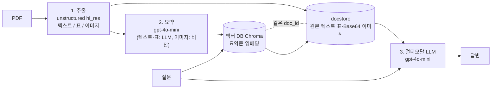
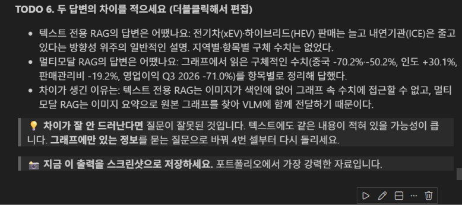
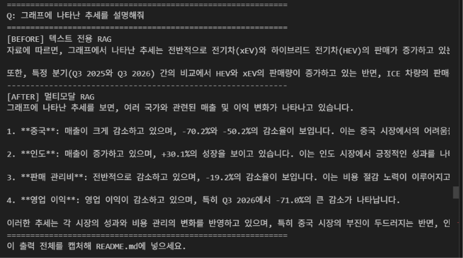

# Multimodal RAG

현대자동차 2026년 3분기 실적 발표 자료(PDF)로 만든 RAG입니다. 본문 텍스트뿐 아니라 표와 그래프 이미지까지 검색 대상에 넣어서, 그래프를 봐야 알 수 있는 수치도 답할 수 있게 하는 것이 목표입니다.

## 1. 문제 정의

이 자료에서 중요한 숫자(지역별 판매량 증감률, 파워트레인 비중, 영업이익 변동)는 대부분 본문이 아니라 그래프와 표 안에 있습니다. 텍스트만 색인하는 일반적인 RAG는 이 숫자를 가져오지 못하고 "HEV 비중이 늘고 있다" 정도의 답만 합니다. 그래서 이미지와 표도 요약해서 색인하고, 답변을 만들 때는 요약이 아니라 원본 그래프 이미지를 모델에 직접 넘겨 수치를 읽게 했습니다.

## 2. 아키텍처



1. 추출: `partition_pdf(strategy="hi_res")`로 텍스트, 표, 이미지를 분리합니다. 텍스트는 2000토큰(겹침 200) 단위로 다시 자릅니다.
2. 요약과 색인: 각 요소를 검색용 요약문으로 만들어 벡터 DB에 넣고, 원본은 docstore에 같은 `doc_id`로 저장합니다. 검색은 요약으로 하고, 모델에 넘기는 것은 원본입니다.
   이렇게 나눈 이유는 이미지나 표 원본(Base64 문자열, 셀 나열)을 그대로 임베딩하면 검색에 쓸 만한 의미가 잡히지 않기 때문입니다. 내용을 설명하는 요약문으로 찾고, 답을 만들 때는 요약이 아니라 원본을 줘야 그래프의 정확한 숫자가 남습니다.
3. 답변: 질문으로 요약을 검색해 원본을 꺼내고, Base64 이미지와 텍스트를 나눠서 멀티모달 모델에 함께 넘깁니다.

## 3. 기술 선택 근거

| 선택 | 이유 |
| --- | --- |
| `gpt-4o-mini` (요약, 답변 모두) | 이미지 입력이 되고 비용이 낮습니다. `gpt-4-vision-preview`는 지원이 끝났습니다. |
| `strategy="hi_res"` | 이 옵션이 없으면 표와 이미지 추출 정확도가 크게 떨어지고 `figures/`가 비기도 합니다. |
| `languages=["kor","eng"]` | 지정하지 않으면 영어로 OCR되어 한글이 깨집니다. |
| 청크 2000토큰, 겹침 200 | 문장이 경계에서 잘려 뜻이 사라지는 일을 줄이려고 겹치게 잘랐습니다. |
| 이미지 요약 프롬프트는 영어 지시에 "한국어로 작성" | 지시 이해는 영어가 안정적이고, 검색은 한국어 질문과 맞아야 하기 때문입니다. |
| `text-embedding-3-small` | 요약문 검색에는 충분하고 저렴합니다. |
| MultiVectorRetriever | 요약으로 찾고 원본(이미지 포함)을 돌려주는 구조라 이 용도에 맞습니다. |

## 4. 프로젝트 구조

```
multimodal-rag/
├── main.py                 # 전체 파이프라인 실행 + 질의응답/Before-After 표 생성
├── src/
│   ├── extract.py          # PDF 파싱·분류·분할
│   ├── summarize.py        # 텍스트·표·이미지 요약
│   └── retriever.py        # 다중 벡터 검색기·최종 체인
├── data/
│   ├── sample_text.pdf     # 원본 PDF (Git 제외)
│   ├── questions.txt       # 질문 목록 (한 줄에 하나)
│   ├── figures/            # 추출된 이미지 (Git 제외)
│   └── processed/          # 추출·요약 결과 pkl (Git 제외)
├── 01~03_*.ipynb           # 단계별 실습 노트북 (추출 / 요약 / 검색기·체인)
├── notebooks/              # 통합 실습 노트북
├── .env.example            # 키 없는 템플릿
└── requirements.txt
```

## 5. 실행 방법

```bash
git clone <저장소 주소>
cd multimodal-rag

python -m venv .venv
source .venv/bin/activate          # 윈도우: .venv\Scripts\activate

pip install --upgrade pip
pip install -r requirements.txt     # 또는 requirements.lock.txt

python -m ipykernel install --user --name multimodal-rag

cp .env.example .env                # 윈도우: copy .env.example .env
# .env 에 실제 OPENAI_API_KEY 입력
```

Poppler와 Tesseract(한국어 언어 데이터 포함)도 설치하고 PATH에 등록해야 합니다. 등록 후에는 터미널과 에디터를 다시 시작하세요. PDF는 `data/sample_text.pdf`에 둡니다.

```bash
python main.py --pdf data/sample_text.pdf   # 처음부터: hi_res 파싱 2~3분 + 요약 API 비용
python main.py --reuse                      # data/processed/*.pkl 재사용 (추출·요약 생략)
```

실행하면 `qa_results.md`에 질의응답 표와 Before/After 전체 답변이 저장됩니다. 노트북으로 한 번에 보려면 `notebooks/Multi_modal_RAG.ipynb`를 위에서부터 실행하면 됩니다. 단계별 실습 노트북은 `01 → 02 → 03` 순서입니다.

## 6. Before / After

텍스트만 색인한 RAG(Before)와 이 프로젝트의 멀티모달 RAG(After)에 같은 질문을 했습니다. 질문은 "그래프에 나타난 추세를 설명해줘"입니다.

| | 답변 |
| --- | --- |
| Before (텍스트 전용) | 본문에 적힌 문장만 근거로 "HEV 도매 비중이 26.8%로 역대 최대, 소매 6.6%" 같은 내용을 답합니다. 그래프에서 읽어야 하는 증감 수치는 나오지 않습니다. |
| After (멀티모달) | 도매 -9.9%, 소매 +3.5%, 인도 도매 +18.8% 등 그래프 안의 숫자가 나옵니다. 다만 질문이 막연해서 어느 그래프를 설명할지 모델이 임의로 고르고, 도넛 중앙의 921 같은 숫자를 "추세"로 풀어 쓰기도 합니다. |

차이가 나는 이유는 Before에는 이미지가 색인에 없어서 그래프 속 숫자에 접근할 수 없고, After는 이미지 요약으로 원본 그래프를 찾아 모델에 직접 보여 주기 때문입니다. 반대로 질문이 구체적일수록 After의 장점이 분명해집니다(아래 질의응답 참고).

이전 실행에서 캡처한 화면입니다.





## 7. 질의응답 5건

그래프나 표를 봐야 답할 수 있는 질문 5개입니다. 정답은 원본 슬라이드(`data/figures/`의 이미지)를 직접 보고 확인했습니다. 답변은 길이 때문에 일부 줄였습니다. 이 표는 검색 후보를 8장으로 늘린 실행 결과입니다.

| # | 질문 | 답변 | 근거 원본 종류 | 소요(초) | 원본 확인 |
|---|---|---|---|---|---|
| 1 | 파워트레인별 판매 표에서 HEV 도매 판매량은 Q3 2025와 Q3 2026에 각각 몇 천 대인가? | Q3 2025 161천 대, Q3 2026 167천 대 | 이미지 4, 텍스트 2, 표 2 | 5.7 | 정답 (table-10-4) |
| 2 | 인도 시장의 산업수요·도매·소매 판매량 증감률을 그래프에서 알려줘 | 산업수요 +30.1%, 도매 +18.8%, 소매 +9.5% | 이미지 8 | 5.0 | 정답 (figure-6-5) |
| 3 | 중국 시장의 도매 판매량은 Q3 2025 대비 Q3 2026에 몇 % 변했나? | 약 -9.4% (1,006천 대 → 911천 대) | 이미지 5, 표 2, 텍스트 1 | 4.8 | 오답. 정답은 -70.2%(32 → 10천 대, figure-6-6). 1,006 → 911은 "중국 제외" 도매량이라 질문과 다른 값 |
| 4 | 영업이익은 Q3 2025 대비 Q3 2026에 얼마나 변했나? 표의 단위를 확인해서 답해줘 | 2,537억 원에서 2,677억 원으로 140억 원 증가 | 이미지 5, 표 3 | 6.0 | 부분 정답. 증가는 맞지만 표 단위가 십억 원이라 1,400억 원 증가(+5.5%)가 맞음(table-12-5). 단위를 확인해 달라고 했는데도 놓침 |
| 5 | 글로벌 도매 판매량은 Q3 2025 대비 Q3 2026에 몇 % 변했나? | -9.9% | 이미지 3, 표 4, 텍스트 1 | 3.8 | 오답. 정답은 1,038 → 921천 대, -11.3%(figure-6-7). -9.9%는 다른 지역 그래프(257 → 232) 값 |

5건 중 정답 2건, 부분 정답 1건, 오답 2건입니다.

검색 후보를 처음 설정인 4장으로 두고 같은 질문을 돌렸을 때는 정답 2건(2, 5번), 부분 정답 1건(4번), 오답 1건(1번: 총계 921을 HEV 값으로 읽음), 답변 실패 1건(3번: 중국 그래프가 후보에 없어 "정보가 없다"고 답함)이었습니다. 후보를 늘리니 1번은 맞았지만, 3번과 5번은 관련 없는 그래프가 같이 들어와 다른 그래프의 숫자를 고르게 되었습니다.

## 8. 한계점

- 질문 5개 중 완전히 맞은 것은 2개입니다. 틀린 경우의 원인은 모두 같은 종류입니다. 필요한 그래프를 찾았더라도 여러 그래프가 같이 들어오면 질문과 맞지 않는 그래프의 숫자를 고릅니다(3번: 중국 제외 값, 5번: 다른 지역 값). 4번은 표 머리글의 단위(십억 원)를 놓쳤습니다.
- 검색 후보 수는 트레이드오프였습니다. 4장일 때는 필요한 그래프가 빠져서 "정보가 없다"고 답하는 경우가 있었고, 8장일 때는 비슷한 그래프가 섞여 틀린 숫자를 자신 있게 답하는 경우가 생겼습니다. 틀린 답을 내는 쪽이 더 나쁘다고 볼 수도 있어서 어느 쪽이 낫다고 결론 내리지 못했습니다.
- 검색은 이미지 요약문에 의존하는데, 요약이 "차트 이미지"처럼 뭉뚱그려지면 해당 그래프가 검색되지 않거나 비슷한 그래프와 구분되지 않습니다. 요약 프롬프트에 지역과 항목명을 반드시 적게 하면 개선될 수 있지만 시도하지 못했습니다.
- 질문이 모호하면 같은 그래프라도 실행마다 다른 값이 나옵니다. 처음 질문 "SUV 판매 비중"은 지역별 도넛이 여러 개라 어떤 실행에서는 77.9 → 74.2%, 다른 실행에서는 69.5 → 76.0%로 나왔고, 둘 다 서로 다른 그래프의 정확한 값이었습니다. 그래서 질문에 지역과 기준(도매, 소매 등)을 적도록 바꿨습니다.
- 표지 같은 일부 텍스트는 OCR이 깨져서 나옵니다.
- `InMemoryStore`와 Chroma 기본 설정은 프로세스가 끝나면 사라집니다. 실제로 쓰려면 파일이나 Redis 저장소와 `persist_directory`가 필요합니다.
- 이미지를 한 장씩 모델로 요약해서 25장에 몇 분이 걸립니다. 이미지 토큰 비용은 따로 계산하지 않았습니다.
- 한 번에 문서 한 편만 다룹니다.

## 9. 보안

`.env`(API 키), `figures/`, `*.pdf`, `*.pkl`, `chroma_db/`는 `.gitignore`로 제외했습니다. 저장소에는 키 없는 `.env.example`만 올렸습니다.
